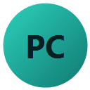
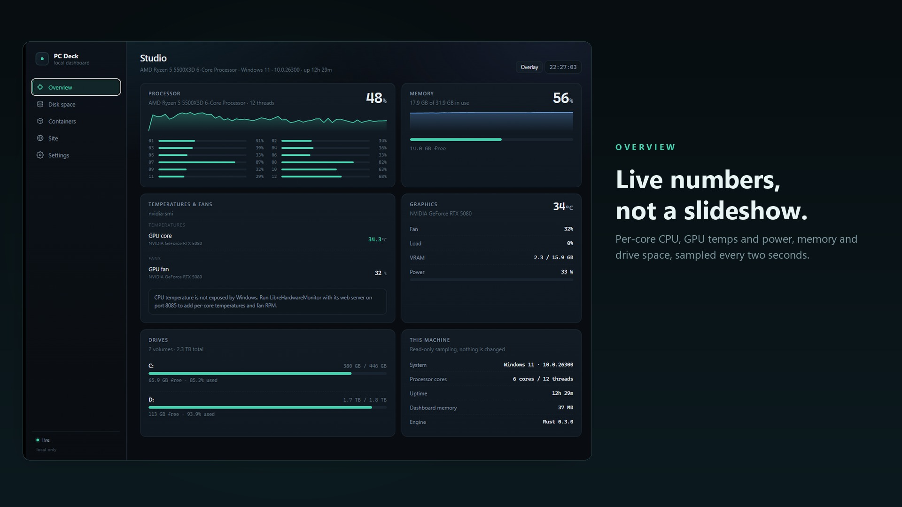
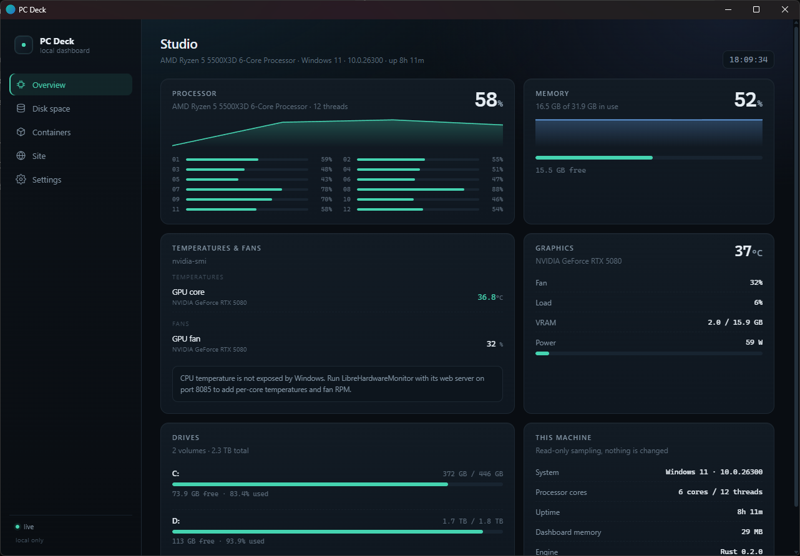
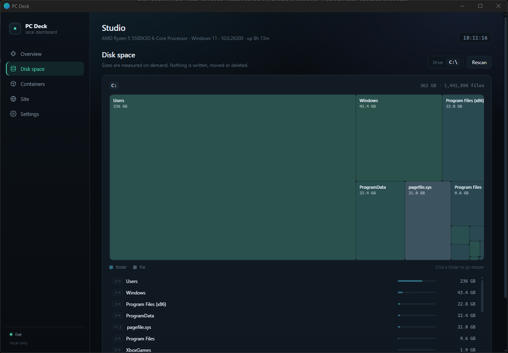
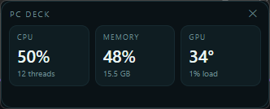

<p align="center">
  
</p>

<h1 align="center">PC Deck</h1>

<p align="center">
  <strong>Your PC, on one page.</strong><br>
  CPU, memory, GPU, temperatures, disk space, Docker and site checks — in a native Windows window.
</p>

<p align="center">
  
  
  
  
</p>

<p align="center">
  <a href="https://github.com/BEEZEDQUEUEONE/pc-deck/releases/latest">
    
  </a>
</p>

> **Looking for the app?** The green **Code → Download ZIP** button on this page gives you the
> **source code**, which contains no executable. Download the app from
> **[Releases → PC-Deck.exe](https://github.com/BEEZEDQUEUEONE/pc-deck/releases/latest)**.

<p align="center">
  <a href="docs/showcase.mp4"></a>
</p>

<p align="center"><a href="docs/showcase.mp4"><strong>▶ Watch the 22-second showcase</strong></a></p>



## What it is

One small `.exe`. No installer, no browser tab, no local server, no account, no telemetry, and no
administrator rights. Double-click it and the window opens.

- **Overview** — CPU load overall and per core with a rolling sparkline, memory, GPU temperature, fan,
  load, VRAM and power, drive capacity, uptime, and how much memory the app itself uses.
- **Overlay** — the **Overlay** button in the header pins a small always-on-top card with CPU, memory and
  GPU beside your work or game. Drag it by its title bar; hide it with the × button, or with Esc
  while the overlay has focus.
- **Disk space** — a WizTree-style squarified treemap with the largest files, a ranked list and
  click-to-drill navigation. Scans are on demand, cached for ten minutes, and capped so a huge drive
  can never hang the app.
- **Containers** — lists Docker containers and allows start, stop and restart. No shell, no deletes.
- **Site** — status code, latency and error for each site you configure, plus quick links.
- **Settings** — four themes, site entries, container options, allowed drives, and the CPU temperature
  helper. Everything is written to `config.json` next to the executable.



<p align="center">
  
</p>

## Download and run

1. Open **[Releases](https://github.com/BEEZEDQUEUEONE/pc-deck/releases/latest)** and download
   **`PC-Deck.exe`**.
2. Put it anywhere you like — Desktop, a tools folder, a USB stick.
3. Double-click it.

On first run a `config.json` is created next to the executable. Your WebView2 profile is kept in
`%LOCALAPPDATA%\PC Deck`, so nothing else is written beside the app.

Windows may show a SmartScreen prompt the first time because the build is not code-signed. Choose
**More info → Run anyway**.

## Requirements

- Windows 10 or 11, 64-bit
- **WebView2 runtime** — included with Windows 11 and current Windows 10; Microsoft offers a one-time
  installer if it is missing
- Optional: Docker Desktop for the containers panel
- Optional: LibreHardwareMonitor for CPU temperatures (the app can fetch it for you)

## CPU temperatures

Windows does not expose CPU temperatures to normal programs. On most desktops there is no ACPI thermal
zone to read at all, so any app that shows CPU package, per-core or motherboard temperatures —
LibreHardwareMonitor, OpenHardwareMonitor, HWiNFO, Core Temp — loads a small kernel driver to talk to
the chip. That driver requires administrator rights, once.

PC Deck does not ship or load a driver itself. In **Settings → CPU temperatures**:

1. Press **Download helper**. It fetches the official LibreHardwareMonitor release from GitHub, verifies
   its SHA-256 checksum and unpacks it into `tools\` next to the executable.
2. Press **Start helper** and approve the Windows prompt. That prompt belongs to the helper, not to
   PC Deck.
3. In the helper window open **Options → Remote Web Server → Run** (port 8085).
4. Press **Test connection** here.

Temperatures and fan RPM then appear, and are picked up automatically on later runs. Already running a
compatible helper? Skip the download and point the URL field at it.

Without a helper the app still works, using the GPU sensors that nvidia-smi exposes.

## Security model

- **No network port is opened.** There is no HTTP server to connect to: the interface is embedded in
  the executable and speaks to Rust through WebView2's in-process IPC.
- The app runs as your normal user. Only the optional helper is elevated, through the standard Windows
  consent prompt.
- No shell is ever executed with user input. Commands use fixed argument lists, and a container action
  is checked against the live container list before it runs.
- Files are only read, only for names and sizes, and only inside the drives listed in `config.json`.
- Outbound requests happen only for the site checks you configure and the optional helper download.
- No telemetry, no analytics, no accounts.

## Configuration

`config.json` sits next to the executable and can be edited by hand or from the Settings panel.

| Key | Default | Purpose |
| --- | --- | --- |
| `theme` | `midnight` | `midnight`, `ember`, `violet` or `daylight`. |
| `diskRoots` | detected drives | Folders the disk map may read. Absolute paths only. |
| `refreshMs` | `2000` | How often the overview samples the machine. |
| `sensorRefreshMs` | `5000` | How often sensors are polled. |
| `docker.enabled` | `true` | Show the containers panel. |
| `docker.refreshMs` | `6000` | Container list refresh interval. |
| `libreHardwareMonitor.enabled` | `true` | Use a local sensor helper. |
| `libreHardwareMonitor.url` | `http://127.0.0.1:8085` | Helper address; must be loopback. |
| `sites` | empty | Site entries, admin URLs and quick links. |

URLs accept `example.com` as well as `https://example.com`.

## Build from source

You need Rust stable and the Microsoft C++ build tools (Rust on Windows links against MSVC):

```bash
rustup-init -y --default-toolchain stable-x86_64-pc-windows-msvc
winget install Microsoft.VisualStudio.2022.BuildTools --override "--quiet --wait --add Microsoft.VisualStudio.Workload.VCTools --includeRecommended"
cargo build --release
```

The result is `target/release/pc-deck.exe` — rename it to `PC Deck.exe` and put it wherever you like.
No Node, npm or web toolchain is involved.

`cargo run -- --selftest` prints what every probe answers without opening a window; useful when
changing a probe.

## Project layout

```
src/
  main.rs           native window, embedded UI, IPC wiring
  api.rs            request dispatcher for the UI's API calls
  config.rs         defaults, validation, settings persistence
  platform.rs       fixed-argument command runner, Windows version, helpers
  bridge.js         page-side bridge that turns API calls into IPC
  probes/
    system.rs       CPU, memory, volumes
    sensors.rs      GPU, helper, ACPI sensor aggregation
    sensors.ps1     PowerShell bridge for names/fans/thermal zones
    helper.rs       optional LibreHardwareMonitor download and launch
    disktree.rs     on-demand disk measurement with limits and caching
    docker.rs       container list and start/stop/restart
    sites.rs        uptime checks
web/                static UI (no framework, no build step, inlined at build time)
  overlay.html      compact always-on-top card
```

## Known limitations

- CPU temperatures require the helper described above; there is no driver-free way on Windows.
- The app needs the WebView2 runtime, which ships with Windows 11 but may need installing on older
  Windows 10 machines.
- Locked system files such as `pagefile.sys` cannot be measured without administrator rights, so a
  drive total can read lower than Windows reports. Permission-protected files are skipped too.
- A disk scan is capped at 1.5 million files or 120 seconds. Reaching either marks the result partial
  rather than hanging.
- Site checks are one request from your PC; there is no history or alerting.
- The helper is fetched at runtime from its own project and is covered by its own licence (MPL-2.0).
  It is not redistributed here.

## Licence

All rights reserved. The source is published so it can be read; copying, modification, redistribution
or republishing any part of it is not permitted. See [LICENSE](LICENSE).
